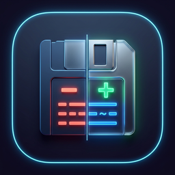
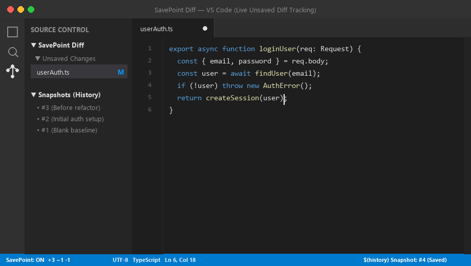

<p align="center">
  
</p>

<h1 align="center">SavePoint Diff</h1>

<p align="center">
  <b>Git-style gutter diff for your unsaved edits — no Git required.</b><br/>
  See exactly what changed since your last save, revert any single change, and roll back to snapshots.
</p>

<p align="center">
  <a href="https://marketplace.visualstudio.com/items?itemName=StayElite.StayElite-Savepoint-Diff"></a>
  
  <a href="./LICENSE"></a>
  
</p>

<p align="center">
  
</p>

---

## ✨ What is it?

SavePoint Diff adds **live, colour-coded gutter markers** and a familiar **Source Control panel entry** for your **unsaved** edits, updated on every keystroke.

It works in **any folder** — Git repo or not. No `.git` folder, no network access, no external services.

> **Git compares against your last *commit*. SavePoint Diff compares against your last *save*.**

## 🎯 Who is it for?

- **Anyone editing outside a Git repo** — scratch files, quick scripts, config folders, generated code.
- **Developers between commits** — see in-progress edits in a messy working tree, or on files Git doesn't track.
- **People reviewing AI-assisted edits** — spot exactly what changed in your buffer before you hit save.
- **Beginners and students** — get Git-like visual feedback without learning Git first.
- **Anyone about to try a risky refactor** — drop a savepoint first and diff against "a minute ago".

## 🚀 Quick start

1. **Install** from the [Marketplace](https://marketplace.visualstudio.com/items?itemName=StayElite.StayElite-Savepoint-Diff), or open Quick Open (`Ctrl+P` / `Cmd+P`) and run:
   ```
   ext install StayElite.StayElite-Savepoint-Diff
   ```
2. **Open any file and start typing.** Gutter markers appear instantly and clear when you save.
3. **Toggle** the extension any time from the `SavePoint: ON` / `SavePoint: OFF` status bar item.

That's it — no configuration needed.

## 🧩 Features

### Live diff

| | Feature | What it does |
|---|---|---|
| 🟢🔵🔴 | **Live gutter markers** | Green = added, blue = modified, red = deleted-line marker. Recalculated on every edit, before you save. |
| 🔍 | **One-click full diff** | Opens VS Code's native split diff: last-saved version on the left, your live editable buffer on the right. |
| 📊 | **Status bar tally** | A running `+added ~modified -deleted` count for the active file, e.g. `SavePoint: ON  +12 ~4 -2`. |
| 🏷️ | **Modified badges** | An "M" badge on changed files in the Explorer and on editor tabs, just like Git. |

### Source Control panel

| | Feature | What it does |
|---|---|---|
| 📁 | **SavePoint Diff panel** | Lists every open file with unsaved changes, in the same place Git lists its changes. |
| 💾 | **Save All / per-file save** | Save everything from the panel toolbar, or one file via its inline save icon. No commit-message box, since there's nothing to commit. |

### Undo, snapshots & safety nets

| | Feature | What it does |
|---|---|---|
| ↺ | **Revert a single change** | Hover any gutter marker and click **"↺ Revert this change"** to restore just that block. The rest of the file is untouched, and no save is needed first. |
| 📍 | **Manual savepoints** | `Create Savepoint` makes the current in-memory content the new diff baseline *without writing to disk*. Ideal before risky edits. |
| 🕒 | **Snapshot history & restore** | Create named checkpoints anytime, or auto-snapshot on every save. Browse the timeline, diff any snapshot against your current buffer, or restore the whole file in one click. |

### Built to fit anywhere

- 🌐 **Works everywhere you code** — local folders, Remote-SSH, WSL, Dev Containers, GitHub Codespaces, and virtual filesystems like vscode.dev / github.dev.
- ⚙️ **Fully configurable** — toggle each marker type, the overview ruler, optional background highlighting, and performance thresholds for large files.
- 🔒 **100% local & private** — everything runs inside the extension host. No Git, no telemetry, no network requests. Baselines live only in memory for the current window session.

## 🆚 How is this different from Git's gutter?

| | Git gutter | SavePoint Diff |
|---|---|---|
| Compares against | Last commit | Last save (or last savepoint) |
| Needs a Git repo | Yes | **No** |
| Works on untracked files | No | **Yes** |
| Updates as you type | Yes | Yes |
| Revert a single change | Yes | Yes |
| Savepoints & snapshots | No | **Yes** |

They work well together: use Git for history across commits, and SavePoint Diff for what you're doing right now.

## ⌨️ Commands

Open the Command Palette (`Ctrl+Shift+P` / `Cmd+Shift+P`) and type **SavePoint Diff**.

| Command | Description |
|---|---|
| `SavePoint Diff: Toggle` | Turn the extension on/off. |
| `SavePoint Diff: Refresh` | Force-recalculate the diff for the active editor. |
| `SavePoint Diff: Clear Decorations` | Clear markers in the active editor without changing the baseline. |
| `SavePoint Diff: Save File` | Save one file (via the inline save icon in the panel). |
| `SavePoint Diff: Save All Unsaved Changes` | Save every file listed in the panel (via the panel toolbar button). |
| `SavePoint Diff: Revert Change (at Cursor)` | Revert the change block at your cursor. Also available from the gutter hover link. |
| `SavePoint Diff: Create Savepoint (Don't Save to Disk)` | Set the current content as the new baseline without writing to disk. |
| `SavePoint Diff: Save Snapshot` | Capture a named/timestamped checkpoint of the current file. |
| `SavePoint Diff: View & Restore Snapshot...` | Open the snapshot history to compare or restore. |
| `SavePoint Diff: Cloud: Connect Storage...` | Set the rclone remote for optional cloud sync and test it. |
| `SavePoint Diff: Cloud: Upload Project Folder...` | Upload a whole project folder to the connected cloud storage. |
| `SavePoint Diff: Cloud: Sync Now` | Sync changed, new and deleted files immediately. |
| `SavePoint Diff: Cloud: View Savepoint History` | Browse the cloud `.savepoint/history.json` log, newest first. |

## ⚙️ Settings

| Setting | Default | Description |
|---|---|---|
| `savepointDiff.enabled` | `true` | Enable/disable the extension globally. |
| `savepointDiff.showAdded` | `true` | Show markers for added lines. |
| `savepointDiff.showModified` | `true` | Show markers for modified lines. |
| `savepointDiff.showDeleted` | `true` | Show markers for deleted-line positions. |
| `savepointDiff.showOverviewRuler` | `true` | Show tick marks in the overview ruler. |
| `savepointDiff.showBackgroundHighlight` | `false` | Lightly tint the background of changed lines. |
| `savepointDiff.enableRevertInHover` | `true` | Show the "↺ Revert this change" link on gutter hover. |
| `savepointDiff.maxFileSize` | `2000000` | Files larger than this many bytes skip live diffing, to protect performance. Invalid values (zero, negative, non-numeric) fall back to the default. |
| `savepointDiff.debounceMs` | `150` | Delay after the last keystroke before recalculating. |
| `savepointDiff.snapshots.enabled` | `true` | Enable/disable snapshot history. |
| `savepointDiff.snapshots.maxSnapshots` | `10` | Maximum snapshots kept per file. |
| `savepointDiff.snapshots.autoSnapshotOnSave` | `true` | Automatically snapshot whenever a file is saved. |
| `savepointDiff.cloud.enabled` | `false` | Optional cloud sync via rclone. Off means no network use. |
| `savepointDiff.cloud.remote` | `""` | rclone remote and folder, e.g. `mydrive:projects/myapp`. |
| `savepointDiff.cloud.rclonePath` | `rclone` | Path to the rclone executable. |
| `savepointDiff.cloud.autoSyncOnSave` | `true` | Sync changed files to the cloud after each save. |
| `savepointDiff.cloud.exclude` | `.git`, `node_modules`, `out`, `.env*` | Names never uploaded (`*` wildcards supported). |

## 🔧 How it works

1. **Baseline** — when a file is opened, its content is captured as the "last saved" baseline.
2. **Live diff** — every edit is diffed against the baseline with a small, well-established Myers line-diff library, then rendered as gutter markers. Updates are debounced so typing stays fast.
3. **Save** — saving resets the baseline and clears all markers; tracking starts fresh.
4. **Undo/redo** — the diff is always recomputed from baseline vs. current text, so undoing back to the saved state clears markers and redoing brings them back.
5. **Reverts & external changes** — if a file stops being dirty without a save (e.g. **Revert File**, or an outside tool rewrote it while your buffer was clean), the baseline re-syncs automatically.
6. **Reverting one change** — applies a single edit that restores just that block's baseline content, then re-diffs. Other changes are untouched.
7. **Savepoints** — move the baseline to the current in-memory content immediately, with no disk write. A later real save simply moves the baseline again.

No Git objects, no filesystem snapshots, no manual delta tracking.

## 📋 Requirements

- VS Code `1.60.0` or later
- Nothing else — no Git, no other extensions (rclone only if you enable cloud sync)

## ⚠️ Known limitations

- **Inside Git repositories**, VS Code's built-in editor-gutter "quick diff" colours are typically driven by Git's own provider. SavePoint Diff's gutter markers, panel entry, badges, and diff view still work independently, in Git and non-Git folders alike.
- **Untitled files** start with an empty baseline, so everything typed shows as "added" until you **Save As**. The saved content then becomes the real baseline.
- **Non-UTF-8 files** restored with unsaved changes after a restart (see "hot exit" in the changelog) have their on-disk baseline read as UTF-8, which can cause inaccurate markers until the next save. Run **SavePoint Diff: Refresh** or save once to resync.
- **Savepoints reset SavePoint Diff's UI, not the file's real dirty state.** After **Create Savepoint**, the panel entry, "M" badge, and status bar count show "no differences" even though the file still has unsaved edits on disk. Use your editor tab's own dirty indicator (the ● dot) to know whether you still need to press `Ctrl+S`.

## 💬 Feedback & support

If SavePoint Diff saves you time, the best ways to help are:

- ⭐ **[Leave a review](https://marketplace.visualstudio.com/items?itemName=StayElite.StayElite-Savepoint-Diff&ssr=false#review-details)** on the Marketplace.
- 🌟 **Star the [GitHub repo](https://github.com/StayElite/SavePoint-Diff).**
- 🐛 **[Report a bug or request a feature](https://github.com/StayElite/SavePoint-Diff/issues).**
- 📣 **Tell a teammate** who edits files outside Git.

## 🤝 Contributing

Contributions are welcome. See [CONTRIBUTING.md](./CONTRIBUTING.md) for build, packaging, and manual test instructions.

## 📝 Release notes

See [CHANGELOG.md](./CHANGELOG.md) for the full history.

## ☁️ Optional cloud sync (GitHub alternative)

Off by default. Requires [rclone](https://rclone.org) (Drive, Mega and many more) configured via `rclone config`.

1. `SavePoint Diff: Cloud: Connect Storage...` — enter an rclone remote like `mydrive:projects/myapp`.
2. `SavePoint Diff: Cloud: Upload Project Folder...` — uploads the folder with its structure (`.git`, `node_modules`, `out`, `.env*` are excluded by default via `savepointDiff.cloud.exclude`).
3. After that, each save syncs only added/modified/deleted files. `Cloud: Sync Now` forces a sync.
4. Every sync that changed something appends an entry (ID, timestamp, changed files, short summary) to `.savepoint/history.json` inside the cloud copy — a `.savepoint/` folder, like `.git`. View it with `Cloud: View Savepoint History`.

Credentials stay in your rclone config; the extension never stores them. Limits: only one folder is synced; two machines writing to the same remote can overwrite each other's log; rclone must be installed where the extension runs (e.g. the remote host in SSH/WSL).

## 🔒 Privacy

Everything happens locally, in memory, inside the extension host. No telemetry. No network requests unless you turn on the optional cloud sync, which only talks to the rclone remote you choose.

## 👤 Author

Created and maintained by **Ashish Sharma (Stay Elite)**.

- GitHub: [StayElite/SavePoint-Diff](https://github.com/StayElite/SavePoint-Diff)
- Issues: [github.com/StayElite/SavePoint-Diff/issues](https://github.com/StayElite/SavePoint-Diff/issues)

## 📄 License

[MIT](./LICENSE) © 2026 Ashish Sharma (Stay Elite)

---

## ❓ Frequently Asked Questions (FAQ)

### How do I see unsaved changes in VS Code without Git?

Install SavePoint Diff, open any file, and start typing. Green, blue, and red gutter markers appear instantly for added, modified, and deleted lines, and clear as soon as you save. There is nothing to configure and no repository is needed:

```
ext install StayElite.StayElite-Savepoint-Diff
```

---

### How do I get Git-style gutter diff markers in a folder that isn't a Git repository?

SavePoint Diff compares your live buffer against the last **save**, not the last commit, so it works in any folder: scratch files, quick scripts, config directories, generated code, or files Git doesn't track. No `.git` folder is required.

---

### What is the difference between SavePoint Diff and Git's gutter?

Git's gutter compares a file to the last **commit**. SavePoint Diff compares it to the last **save** (or your last manual savepoint), updates on every keystroke, and doesn't need a repository. They complement each other: use Git for history between commits and SavePoint Diff for what you're doing right now.

---

### How do I revert a single change without undoing everything else?

Hover over any gutter marker and click **"↺ Revert this change"**. Only that block returns to its baseline content, and the rest of the file is untouched. You can also place your cursor inside a change and run this from the Command Palette:

```
SavePoint Diff: Revert Change (at Cursor)
```

---

### How do I create a restore point before a risky refactor?

Use a **savepoint** to diff against "a minute ago" without writing anything to disk, or a **snapshot** for a named checkpoint you can restore later:

```
SavePoint Diff: Create Savepoint (Don't Save to Disk)
SavePoint Diff: Save Snapshot
```

---

### How do I restore an earlier version of a file?

Run `SavePoint Diff: View & Restore Snapshot...` from the Command Palette. You can browse the snapshot timeline for the active file, open a split diff of any snapshot against your current buffer, or revert the whole file to that snapshot in one click. Snapshots are taken automatically on every save, and the last 10 per file are kept by default:

```jsonc
{
  "savepointDiff.snapshots.enabled": true,
  "savepointDiff.snapshots.autoSnapshotOnSave": true,
  "savepointDiff.snapshots.maxSnapshots": 10
}
```

---

### How can I review what an AI coding assistant changed before I save?

If the assistant's edits land in your editor as unsaved changes, SavePoint Diff highlights them in the gutter, lists the file in the **SavePoint Diff** panel, and lets you open a full split diff or revert individual blocks. If a tool saves files automatically, the baseline moves forward on each save, so run `SavePoint Diff: Save Snapshot` first to keep a checkpoint you can diff against.

---

### Why don't I see the gutter colours inside my Git repository?

Inside Git repositories, VS Code's built-in "quick diff" gutter colours are usually driven by Git's own provider. SavePoint Diff's Source Control panel entry, "M" badges, status bar count, and split diff view still work independently, in Git and non-Git folders alike.

---

### How do I save all my unsaved files at once?

Click the **Save All** button at the top of the **SavePoint Diff** panel in the Source Control view, or use the inline save icon on a single row to save just that file. You can also run this from the Command Palette:

```
SavePoint Diff: Save All Unsaved Changes
```

---

### How do I hide certain markers or speed up SavePoint Diff on large files?

Every marker type can be toggled, and large files skip live diffing above a size limit (about 2 MB by default). Add any of these to your `settings.json`:

```jsonc
{
  "savepointDiff.showDeleted": false,
  "savepointDiff.showBackgroundHighlight": true,
  "savepointDiff.maxFileSize": 2000000,
  "savepointDiff.debounceMs": 150
}
```

---

### Why does the panel show "no differences" after I created a savepoint, even though my tab still has the unsaved dot?

A savepoint moves the diff baseline to your current in-memory content without writing to disk, so SavePoint Diff's panel entry, badge, and status bar count correctly show no differences from that baseline. The file itself still has unsaved edits. Rely on the editor tab's own dirty indicator (the ● dot) to know whether you still need to press `Ctrl+S`.

---

### Why does everything show as "added" in a new untitled file?

Untitled files start with an empty baseline, so every line you type counts as added. Once you use **Save As**, the saved content becomes the real baseline and tracking works normally.

---

### Does SavePoint Diff work in Remote-SSH, WSL, Dev Containers, Codespaces, and vscode.dev?

Yes. It runs entirely inside the extension host and works with local folders, Remote-SSH, WSL, Dev Containers, GitHub Codespaces, and virtual filesystems like vscode.dev and github.dev.

---

### Does SavePoint Diff send my code anywhere or collect telemetry?

No telemetry, ever. Everything runs locally unless you opt in to cloud sync, which uploads to the rclone remote you choose. Baselines are never written to disk and exist only for the current window session.

---

### Does SavePoint Diff replace Git?

No. It only tracks unsaved edits and short-term snapshots of individual files. Keep using Git for commits, branches, and project history.
